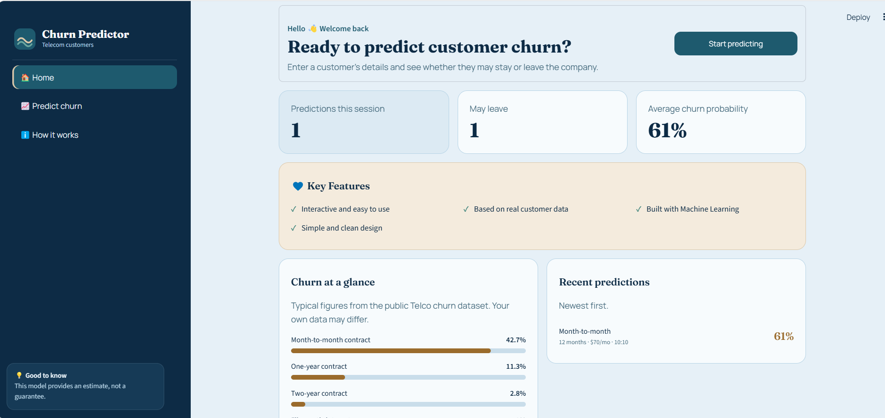
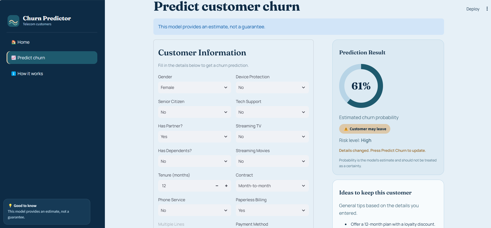
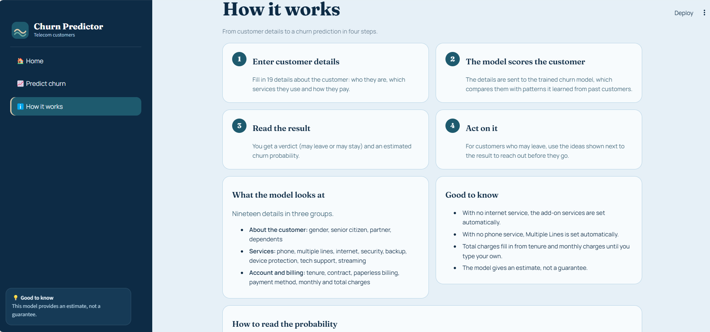

# Customer Churn Prediction

A Machine Learning project that predicts whether a customer is likely to leave a telecommunications company using Logistic Regression and an interactive Streamlit web application.

## Application Screenshots

### 1. Home Page



### 2. Churn Prediction Result



### 3. How It Works



## Project Overview

Customer churn occurs when a customer stops using a company's services. Predicting churn helps businesses identify customers who may leave and take steps to improve customer retention.

This project uses customer information, service details, contract types, and billing information to predict churn.

## Objectives

- Predict whether a customer is likely to leave.
- Explore customer data and identify churn patterns.
- Clean and preprocess the dataset.
- Train and evaluate a Logistic Regression model.
- Build an interactive web application using Streamlit.

## Technologies Used

- Python
- Pandas
- NumPy
- Matplotlib
- Seaborn
- Scikit-learn
- Streamlit
- Joblib
- Jupyter Notebook

## Dataset

The project uses the Telco Customer Churn dataset, which contains customer demographics, subscribed services, contract information, billing details, tenure, and churn status.

The target column is `Churn`:

- **Yes:** The customer left the company.
- **No:** The customer did not leave the company.

## Machine Learning Workflow

1. Data loading and exploration
2. Data cleaning and preprocessing
3. Exploratory Data Analysis (EDA)
4. Feature preparation and encoding
5. Train-test split
6. Logistic Regression model training
7. Model evaluation
8. Churn prediction through the Streamlit application

## Model Performance

The Logistic Regression model was evaluated using a test dataset.

| Metric | Result |
|---|---:|
| Accuracy | 80.38% |
| ROC-AUC | 83.59% |

The model was also evaluated using precision, recall, F1-score, and a confusion matrix.

These results provide a baseline for predicting customer churn. The model can be improved further through feature engineering, hyperparameter tuning, and experimentation with other classification algorithms.

## Project Structure

```text
Customer-Churn-Prediction/
│
├── app.py
├── requirements.txt
├── README.md
├── .gitignore
│
├── assets/
│   ├── home.png
│   ├── prediction.png
│   └── how-it-works.png
│
├── data/
│   └── WA_Fn-UseC_-Telco-Customer-Churn.csv
│
├── models/
│   └── churn_model.joblib
│
├── notebook/
│   └── 01_eda.ipynb
│
└── src/
    ├── train.py
    └── predict.py
```

## Installation and Setup

### 1. Clone the Repository

```bash
git clone https://github.com/hadiazia0328-lab/Customer-Churn-Prediction.git
```

### 2. Navigate to the Project Folder

```bash
cd Customer-Churn-Prediction
```

### 3. Create a Virtual Environment

```bash
python -m venv venv
```

### 4. Activate the Virtual Environment

**Windows PowerShell:**

```powershell
.\venv\Scripts\Activate.ps1
```

If PowerShell blocks activation, run:

```powershell
Set-ExecutionPolicy -Scope Process -ExecutionPolicy RemoteSigned
.\venv\Scripts\Activate.ps1
```

### 5. Install Dependencies

```bash
python -m pip install -r requirements.txt
```

### 6. Run the Streamlit Application

```bash
python -m streamlit run app.py
```

The application will open in your browser.

## Future Improvements

- Experiment with Random Forest and other classification models.
- Improve recall for customers likely to churn.
- Add feature importance and explainable predictions.
- Improve the user interface and customer retention recommendations.

## Author

**Hadia Zia**

Machine Learning Project | Customer Churn Prediction

---

*This project was developed for learning and practical application of Machine Learning, data analysis, model evaluation, and web application development.*